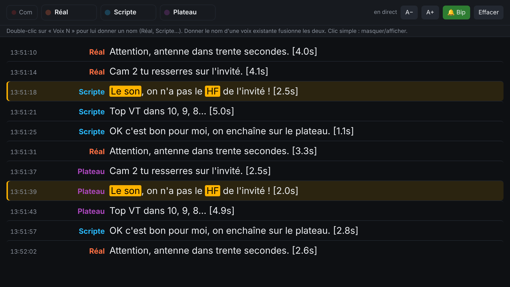

# Intercom Live

Transcription en direct de la com de régie : qui parle et ce qu'il dit, dans une fenêtre sur le Mac,
pour pouvoir faire le son sans écouter la com. Tout tourne en local : aucun son ne part sur Internet
(seuls les modèles sont téléchargés au premier lancement).

## Comment ça marche (mode mono, Solidcom M1)

1. **Branchement** : la sortie audio mono du Solidcom M1 entre dans une interface audio du Mac
   (n'importe quelle carte son USB, entrée ligne). On choisit l'interface et l'entrée dans `config.toml`.
2. **Détection de parole** : dès que ça parle, le voyant « Com » s'allume. Le bruit de fond de la com
   (souffle, ventilation) est mesuré en continu pour ne pas déclencher dessus.
3. **Transcription Whisper locale** à la fin de chaque phrase (ou toutes les 12 s si ça parle longtemps).
   Sur Mac Apple Silicon, le moteur `mlx-whisper` est utilisé (rapide), sinon `faster-whisper`.
4. **Qui parle** : chaque phrase est comparée aux empreintes vocales déjà entendues. Une nouvelle
   personne apparaît en « Voix 1 », « Voix 2 »… **Clic sur le badge** pour : la renommer (Réal, Scripte…),
   la fusionner avec une autre (« c'est la même personne que… »), l'**ignorer** (retour antenne, plateau :
   ses phrases ne s'affichent plus, même aux prochaines émissions) ou la supprimer.
   Les voix nommées sont retenues : à l'émission suivante, la réal est reconnue directement.
5. **Mots-clés** (« le son », ton prénom, « HF »…) : ligne surlignée + bip.
6. Tout est aussi écrit dans `~/Documents/Intercom Live/transcripts/com_<date>.txt`.

Tes voix nommées, tes réglages et les transcriptions sont rangés dans **Documents > Intercom Live**,
hors du dossier de l'app : pour mettre à jour, tu peux remplacer le dossier `intercom-live` sans rien perdre
(seule la première relance réinstalle les modules, quelques minutes).

## Installation (une seule fois)

Colle cette ligne dans **Terminal** :

    bash -c "$(curl -fsSL https://raw.githubusercontent.com/ClementLprt/Test/main/install.sh)"

Elle télécharge l'app dans `Documents/Intercom Live/app`, installe ce qu'il faut (si ton Mac n'a pas de
Python 3.11–3.13, elle propose d'en installer un rien que pour l'app) et crée **Intercom Live** dans ton
dossier Applications. Glisse-la dans le Dock. Au premier lancement, macOS demande l'accès au micro : accepte.

Ensuite, plus jamais de Terminal :
- **Lancer** : clic sur l'icône. La fenêtre s'ouvre (fenêtre d'app Chrome si tu l'as, sinon ton navigateur).
- **Quitter** : bouton « Quitter » dans la fenêtre, ou clic droit sur l'icône du Dock > Quitter.
- **Mises à jour** : automatiques. L'app vérifie toutes les 2 minutes ; quand une nouvelle version est publiée,
  elle se télécharge et l'app redémarre toute seule en quelques secondes (tes voix et réglages restent).

En cas de souci, le journal est dans `Documents/Intercom Live/app/dernier_lancement.log`.

## Choisir la carte son et l'entrée

Dans la fenêtre, bouton **⚙ Entrée** (il s'ouvre tout seul au premier lancement) : choisis la carte son,
puis l'entrée où arrive la sortie du Solidcom. Le vumètre doit bouger quand ça parle sur la com.
Le choix est retenu. Tu viens de brancher une carte ? Bouton **↻ Rafraîchir**.

**Seuil** : le curseur sous le vumètre (trait blanc). Tout ce qui reste en dessous n'est pas transcrit.
Monte-le juste au-dessus du niveau du retour antenne / son du live qui passe dans la com : le vumètre
doit dépasser le trait seulement quand quelqu'un parle directement dans la com.

Si aucune carte n'apparaît ou que le vumètre reste à plat : Réglages Système > Confidentialité et sécurité >
Micro, et autorise **Terminal**.

## Réglages avancés (`config.toml`)

1. `gain_db` : à monter si la com arrive bas.
2. `[vad] threshold_db` : remonte-le (ex. -38) si du bruit déclenche, baisse-le si des mots sont ratés.
3. `[voix] seuil` : trop de « Voix N » pour une même personne → baisse à 0.35 ;
   deux personnes confondues → monte à 0.5.
4. `initial_prompt` : ajoute les noms propres de l'émission (invités, cadreurs, rubriques).
5. `keywords` : ce qui doit te faire lever la tête.

Dans la fenêtre (http://127.0.0.1:8765) : clic sur un badge pour gérer une voix, A−/A+ pour la taille du
texte, 🔔 pour couper le bip.

Si un jour tu as une sortie par poste (Dante, MADI…), passe `mode = "multi"` : chaque canal donne
directement le nom, sans reconnaissance de voix.

## Tester sans la régie

- `./lancer.command --file enregistrement.wav` rejoue un enregistrement de com (mono ou multi-piste).
  La fenêtre reste ouverte à la fin pour nommer les voix et relire.
- `--fake-asr` remplace Whisper par des phrases bidon pour vérifier le branchement, les seuils et la
  reconnaissance des voix sans attendre le modèle.
- `--speed 0` rejoue un fichier le plus vite possible.

## Latence attendue

Texte affiché environ 1 à 2 s après la fin de la phrase sur un Mac M1/M2/M3 avec `large-v3-turbo`.
Si c'est trop lent : `model = "small"` (moins précis), ou baisse `hangover_ms`.

## Limites connues

- Deux personnes qui parlent en même temps : la phrase est attribuée à la voix dominante.
- Une réponse très courte (« ok », « top ») est rattachée à la voix la plus proche, sans créer de nouvelle voix.
- Le changement de voix est repéré au silence entre deux phrases (~0,45 s) et entre les phrases
  découpées par Whisper ; deux interlocuteurs qui s'enchaînent sans aucune pause peuvent être fusionnés
  sur une ligne.
- La qualité dépend de la com : un micro casque très compressé rend les voix plus proches entre elles.
